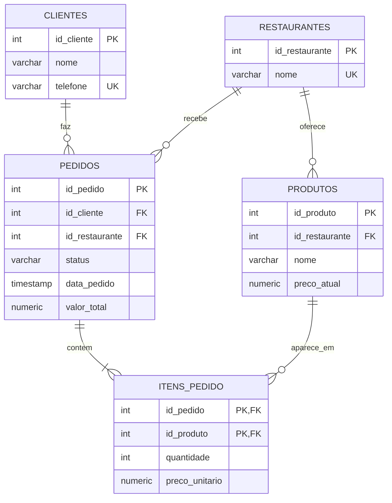

# Modelagem – DER em 3ª Forma Normal

## Antes

Uma única tabela `pedidos` com `lista_produtos` em texto (vários produtos na mesma coluna) e os dados do
cliente e do restaurante repetidos em cada linha.

## Depois

## Decisões

- **1FN:** cada produto do pedido vira uma linha em `itens_pedido`; nomes repetidos na lista viram `quantidade`.
- **2FN:** em `itens_pedido`, a PK é composta (`id_pedido`, `id_produto`) e `quantidade` e `preco_unitario` dependem dela inteira.
- **3FN:** dados do cliente e do restaurante saem de `pedidos` e ficam em tabelas próprias, ligadas por FK.
- **Preço:** `preco_unitario` fica gravado no item para manter o valor histórico mesmo se o cardápio mudar.
